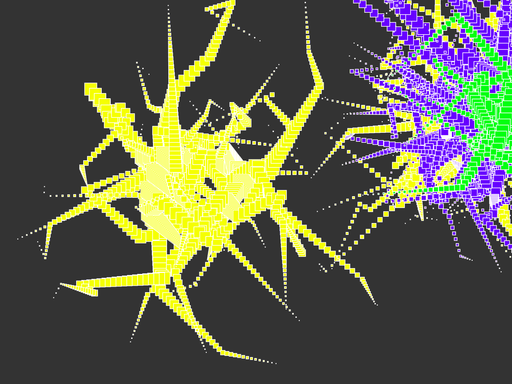

# E0. Il primo sketch con p5.js

Lavoro pubblico: https://yesha27-student.github.io/aa2627-tad-es/es0/

> `preview.png` va creata quando il lavoro è pronto, perché serve all'anteprima nella pagina delle revisioni del corso. GitHub mostra questa immagine: finché manca, si vede il segno di un'immagine mancante, ed è il modo più semplice per accorgersene.
